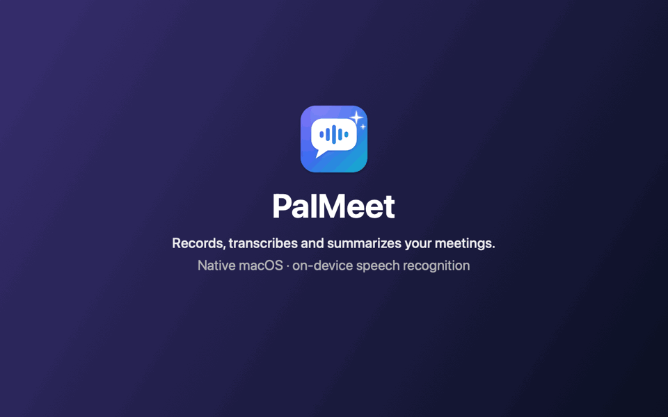
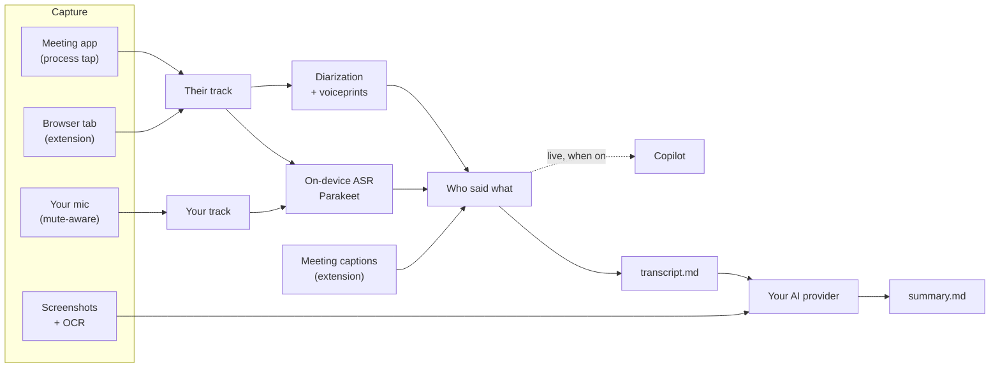

<p align="center">
  
</p>

<h1 align="center">PalMeet</h1>

<p align="center">
  <b>Records, transcribes and summarizes your meetings, natively on your Mac.</b><br>
  Any app window or browser tab · on-device speech recognition · the AI you already use
</p>

<p align="center">
  
  
  
  <a href="LICENSE"></a>
</p>

<p align="center">
  
  <br>
  <sub>A made-up meeting, rendered from the app's real windows · <a href="docs/demo.mp4">watch as video</a></sub>
</p>

## Highlights

- **Any meeting.** Zoom, Microsoft Teams, Slack, Webex, Discord and FaceTime, or a Google Meet / Teams / Zoom tab in Chrome, Edge, Brave, Arc or Vivaldi. Record several at once; each stays separate.
- **Clean audio.** Their audio and your mic go to separate tracks. Browser tabs are captured one by one through the companion extension, even across Chrome profiles. Your mic only counts where you're unmuted, never in a call you're not recording.
- **Who said what.** Speakers are named from the meeting's own live captions, and from voices PalMeet learned in earlier meetings. Name someone once and they're recognized next time.
- **A summary you can use.** A Markdown summary with TL;DR, decisions, action items with owners, open questions, risks, your commitments, quotes and the key screenshots. It's written by Claude, Codex, Gemini, Cursor or a local model, through an API key or the CLI login you already have.
- **Live copilot, only when you want it.** It suggests answers when someone asks you something and questions worth asking, using the context you typed (agenda, ticket, who's who). Off means nothing is analyzed or sent.
- **Private by design.** Transcription runs on device, and only text goes to the AI provider you chose. PalMeet's windows are hidden from screen sharing, and API keys live in the Keychain.
- **Light on disk.** Audio is compressed after processing and can be deleted after N days. Repeated screenshots are removed.
- **Keyboard first.** Hotkeys for everything, plus adjustable transparency and click-through windows.

## How it works



Everything for a meeting is saved in `~/Documents/PalMeet/<date time> – <title>/`.

## Getting started

**Requirements:** Apple Silicon and macOS 15 or later. Building needs Xcode 26 and XcodeGen (`brew install xcodegen`).

```bash
scripts/create-dev-cert.sh       # once: a local code-signing certificate (keeps privacy permissions across updates)
scripts/install.sh --rebuild     # builds, installs /Applications/PalMeet.app, registers the browser connector, launches it
```

`scripts/make-dmg.sh` makes a drag-to-install disk image instead (`build/PalMeet-<version>.dmg`).

**First run**

1. **Permissions.** Onboarding asks for Screen & System Audio Recording and Microphone. Accessibility is optional; it reads mute and sharing state from the Zoom and Teams desktop apps, and notices when you're talking in a call that isn't being recorded.
2. **AI provider.** Settings → AI Providers.
   - CLIs reuse your login: `claude`, `codex`, `gemini`, `cursor-agent`.
   - APIs need a key, stored in the Keychain.
   - If the provider you picked doesn't work, PalMeet uses one that does and says so.
3. **Speech models.** The first transcription downloads about 600 MB of models to `~/Library/Application Support/FluidAudio`.

**Record a meeting:** press `⌃⌥R` with the meeting window in front, or click Record and pick one or more meetings. Stop with `⌃⌥R` or `⌃⌥E`; the transcript and summary follow a minute later.

## Browser meetings and Chrome profiles

Chrome plays every tab of every profile through one process, so recording a single tab needs the companion extension:

1. Settings → Browser Extension → **Install connector** (registers the native-messaging host).
2. In each profile you use for meetings: `chrome://extensions` → Developer mode → **Load unpacked** → `~/Library/Application Support/PalMeet/Chrome Extension` (Settings → Browser Extension → **Set up…** opens it). The extension reloads itself after PalMeet updates.
3. Meeting tabs appear in the picker as "Chrome · Work · Google Meet – …".
4. Chrome needs one click per meeting: click the PalMeet icon (it blinks **REC?**) or press `⌥⇧R` in that window. Until then the live view shows an orange banner. Pin the extension so the icon is always visible.
5. Turn on the meeting's live captions (Meet: CC; Teams: … → Language and speech → Show live captions) and speakers are named from them.

Details: [Extension/chromium/README.md](Extension/chromium/README.md) and [PROTOCOL.md](Extension/chromium/PROTOCOL.md).

## Hotkeys

All of them can be changed in Settings → Hotkeys. `⌃⌥/` shows the cheat sheet.

| | |
|---|---|
| `⌃⌥R` record frontmost meeting / stop | `⌃⌥N` add another meeting |
| `⌃⌥P` pause / resume | `⌃⌥E` stop & summarize |
| `⌃⌥S` mark moment + screenshot | `⌃⌥K` quick note |
| `⌃⌥M` cycle mic routing | `⌃⌥C` copilot on / off |
| `⌃⌥H` help me now | `⌃⌥1/2/3` copy suggestion |
| `⌃⌥Space` copilot panel | `⌃⌥W` main window |
| `⌃⌥\` panic hide | `⌃⌥↑/↓/0` opacity |
| `⌃⌥T` click-through | |

## Who said what

Remote speech is attributed in this order (`SpeakerAttribution`):

1. **Meeting captions.** With the extension and live captions on, Teams, Meet and Zoom label each caption with the speaker's name. Caption text is aligned to the transcribed words, and those words take that name. This splits people the diarizer lumped together and merges one person it split.
2. **Voice clusters** from the diarizer, named by most of their caption-labelled words, by "is speaking" indicators, or by a voice learned earlier. On real recordings the same voice scores 0.92–0.96 and different people at most 0.44; PalMeet needs at least 0.65 with a clear winner.
3. Otherwise "Speaker N", which the summary may name from what people say. It never overrides names from you, the meeting or a known voice.

Naming a speaker in Review, or the meeting naming them, teaches PalMeet their voice (after at least 8 s of speech). Known voices are listed in Settings → General → Who said what.

## Privacy and storage

- **On device:** audio capture, speech recognition, speaker detection, OCR and voiceprints.
- **Sent to your AI provider:** the transcript, your notes and context, and a few screenshots, when a summary is written. The copilot also sends recent lines, but only while it's on.
- **Never stored outside your Mac:** recordings, voiceprints (`~/Library/Application Support/PalMeet/Voices.json`) and settings. API keys are kept in the Keychain.
- **Invisible to screen sharing:** PalMeet windows are excluded from screen capture and can hide automatically while you present.
- **Settings → Privacy → Recordings** controls:
  - how audio is kept after processing: compressed AAC (≈6× smaller, the default), lossless (≈2×) or original;
  - whether repeated screenshots are removed;
  - when audio is deleted (transcripts and summaries stay).

## Files

| File | Contents |
|---|---|
| `summary.md` / `summary.json` | TL;DR, decisions, action items, takeaways, topics, open questions, risks, your commitments, quotes, screenshots |
| `transcript.md` / `transcript.json` | Speaker-attributed transcript with timestamps |
| `audio/them.m4a`, `audio/me.m4a` | The two tracks (16 kHz). Recorded as `.caf`, re-saved per the storage setting once the meeting is processed. Transcribing again from AAC can differ by ≈3% of words |
| `screenshots/*.jpg`, `index.json` | Screenshots with their OCR text; repeats are removed after the summary (marked ones and the summary's stay) |
| `context.md` | The meeting context you typed |
| `copilot.json`, `notes.json`, `session.json` | Copilot suggestions, your notes, metadata |
| `meeting-speakers.json`, `speaker-voices.json` | Captions and speaking indicators from the meeting page; each remote speaker's voiceprint |
| `page-diagnostics.jsonl` | Which meeting-page elements changed (helps support new meeting-site layouts) |

## Development

```bash
scripts/build-app.sh Release        # or Debug → build/PalMeet.app (App/PalMeet.xcodeproj is generated from App/project.yml)
swift scripts/make-icon.swift       # regenerate the app icon
scripts/make-demo-video.sh          # re-render docs/demo.gif and docs/demo.mp4 (made-up data, off screen)
```

| Module | Responsibility |
|---|---|
| `SessionKit` | Models, on-disk layout, Markdown renderers |
| `CaptureKit` | Window list, Core Audio process taps, shared mic (echo cancellation), frame sampling, permissions, Accessibility meeting state |
| `BrowserBridge` | Localhost WebSocket bridge + native-messaging pairing with the Chromium extension |
| `TranscriptKit` | Parakeet ASR (FluidAudio), diarization, voiceprints, transcript assembly, speaker attribution |
| `VisionContext` | OCR, perceptual hash, screenshot keep policy |
| `LLMKit` | Anthropic, OpenAI-compatible and Gemini APIs; Claude Code, Codex, Gemini and Cursor CLIs; Keychain |
| `CopilotKit` | Question detection, prompts, meeting-type playbooks, streaming copilot engine (strict on/off) |
| `PalMeetCore` | `SessionManager` (concurrent sessions, mic routing, bridge events), `MeetingSession`, summarizer, storage |
| `PalMeet` | The app: menu bar, main window, picker, review, copilot panel, settings, hotkeys, window privacy |

**Tests**

```bash
swift test                                                            # unit + local integration tests (no network)
node --test Extension/chromium/tests/*.test.mjs                       # extension logic (+ real DOM with PALMEET_CHROME)
PALMEET_INTEGRATION=1 swift test --filter RealPipelineTests           # whole sessions with the real models (EN + PT)
PALMEET_INTEGRATION=1 swift test --filter RealAudioIntegrationTests   # real ASR + diarization on synthetic voices
PALMEET_INTEGRATION=1 swift test --filter LiveSummaryTests            # real summary via the Claude Code CLI
PALMEET_CHROME="…/Google Chrome for Testing" PALMEET_INTEGRATION=1 swift test --filter ChromeExtensionE2ETests
PALMEET_SESSION_DIRS="<copied session>:<other>" swift test --filter RealSessionTests   # voice learning on real recordings
PALMEET_COMPRESSION_FILE=<copied .caf> swift test --filter CompressionQualityTests     # audio formats vs transcription
open build/PalMeet.app --args --self-test /tmp/palmeet-self-test.json # taps, mic, screen capture, invisibility
scripts/smoke-test.sh                                                 # app launches and stays idle
```

If Chrome's own audio is muted (e.g. launched with `--mute-audio`), tab capture records silence. Keep the meeting tab unmuted.

**Releases and updates.** PalMeet updates itself with [Sparkle](https://sparkle-project.org). `scripts/release.sh <version> notes.md` builds and signs a Release. It then adds the EdDSA-signed zip to `appcast.xml` on the `releases` branch, tags `v<version>` and pushes. Installed apps pick it up on their daily check, or straight away with Check for Updates…. Updates wait until no meeting is being recorded.
- **Private repo feed:** the app authenticates with your GitHub CLI login (`gh auth token`, read at check time, never stored) or a read-only token saved in Settings → Updates.
- **Back up the signing key:** `.build/artifacts/sparkle/Sparkle/bin/generate_keys --account palmeet -x palmeet-sparkle-key.txt`. Without it, installed copies can't be updated.

Builds are signed with a local certificate, not a Developer ID, so on another Mac the first launch needs right-click → Open. With a Developer ID, set `PALMEET_SIGN_IDENTITY="Developer ID Application: …"` and notarize.

## Limitations

- **Echo cancellation can be unavailable.** On some Macs, macOS voice processing fails to start (`-10875`). PalMeet then records the plain mic, and a transcript filter drops lines that repeat the remote audio. On speakers instead of headphones, some echo may remain.
- **Meeting pages change.** The caption, speaking and mute readers follow today's Teams, Meet and Zoom pages. `page-diagnostics.jsonl` from a real meeting shows what to adjust.
- **Not built yet:** automatic meeting detection, calendar attendees, synced audio playback in Review, cloud ASR. See [PLAN.md](PLAN.md).

## Acknowledgments

- [FluidAudio](https://github.com/FluidInference/FluidAudio) (Apache-2.0): Parakeet speech recognition and speaker diarization on the Neural Engine.
- [Sparkle](https://github.com/sparkle-project/Sparkle) (MIT): updates.
- [KeyboardShortcuts](https://github.com/sindresorhus/KeyboardShortcuts) (MIT): global hotkeys.

## License

[MIT](LICENSE) © 2026 Isac Santos
